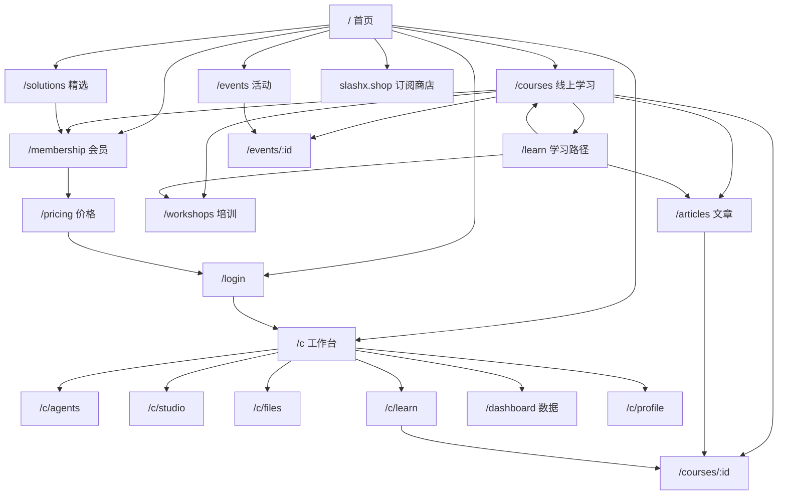

# 参考站地图（自 `/c/learn` 向外）

抓取时间：2026-11-15。起点是 `https://www.slashx.cn/c/learn`。应用内路由在浏览器里会跳到登录页，因此工作台正文以关闭脚本后的服务端 HTML 和接口为准；营销页、课程详情、活动、文章可以在未登录状态下完整打开。未提交任何表单，未注册账号。

公开站点地图 `https://www.slashx.cn/sitemap.xml` 约 89 条：首页与栏目页、约 45 个课程详情、约 20 篇文章、9 个活动详情，以及两份协议。

## 页面树

```text
slashx.cn
├── /                          营销首页
├── /courses                   线上学习（与学习页同一套共学版式，并含章节）
│   └── /courses/:id           课程详情（左目录 + 右播放位）
├── /learn                     学习路径说明（另一套版式，不是 /c/learn）
├── /articles                  文章 / 图文教程
│   ├── ?topic=tutorial|event|about
│   ├── ?page=1
│   └── /articles/:slug
├── /events                    活动中心
│   └── /events/:id
├── /workshops                 实战培训介绍
├── /solutions                 精选供给
│   └── /solutions/:slug
├── /membership                会员权益
├── /pricing                   价格（会员卡 + 平台四档）
├── /login                     登录或注册（也承接工作台回跳）
├── /about
├── /demands
├── /skills
├── /platform
├── /enterprise
├── /extension
├── /developers
├── /instructors/:slug
├── /group-buys/:id
├── /legal/terms|privacy|credits-policy|developer-terms
├── /profile/affiliate|wallet|redeem|membership   未登录时进入登录页
├── /c                         对话（工作台）
│   ├── /c/agents              智能体
│   ├── /c/studio              创作
│   ├── /c/files               我的文件
│   ├── /c/learn               学习（本次视觉参考）
│   │   └── /c/learn/:id       工作台内课程页（未登录跳登录）
│   └── /c/profile             我的
├── /dashboard                 侧栏「数据」
└── 外链
    ├── https://slashx.shop/           顶栏「Codex订阅」
    ├── https://slashx.shop/redeem     供给详情中的兑换
    └── https://slashx.shop/#plans
```

未发现路径：`/signup`、`/register`、`/c/chat`（404）、`/c/token`、`/proxy`。顶栏和页脚都没有名为「Token代理」的入口。和「额度 / 令牌」最接近的公开位置是：

- 顶栏「Codex订阅」→ 外部订阅商店（套餐、购买流程、自助兑换）
- 登录后的 `/profile/wallet`（对话页文案里的「平台积分 / 我的钱包」）
- `/developers` 正文中的 PAT / Token 配置说明（不是独立产品页）
- 文章筛选「图文教程」即教程；「课程」是 `/courses` 与 `/c/learn`

## 导航关系



工作台侧栏（`/c/learn` 服务端 HTML）从左到右的含义是图标按钮，悬停出文字：

| 标签 | 去向 |
| --- | --- |
| 对话 | `/c` |
| 智能体 | `/c/agents` |
| 创作 | `/c/studio` |
| 我的文件 | `/c/files` |
| 学习 | `/c/learn` |
| 数据 | `/dashboard` |
| 我的 | `/c/profile` |
| 工作台 | 按钮，营销顶栏的「进入工作台」则到 `/login?callbackUrl=/c` |

营销顶栏：首页 `/`、线上学习 `/courses`、线下活动 `/events`、精选联盟 `/solutions`、推广联盟 `/profile/affiliate`、Codex订阅 `https://slashx.shop/`、加入会员 `/membership`、进入工作台 `/login?callbackUrl=/c`。

页脚：课程、文章、活动、需求、精选供给、会员权益、Skill/MCP、开发者、关于我们，以及四份协议和邮箱。
